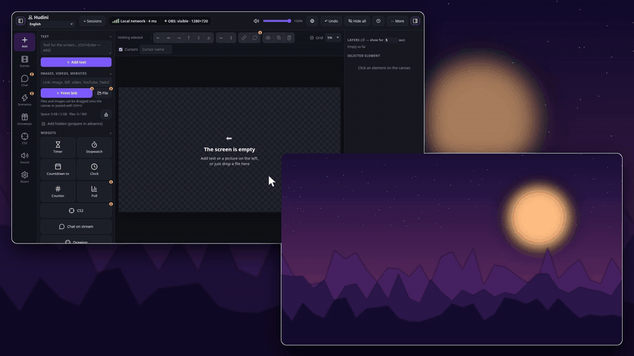
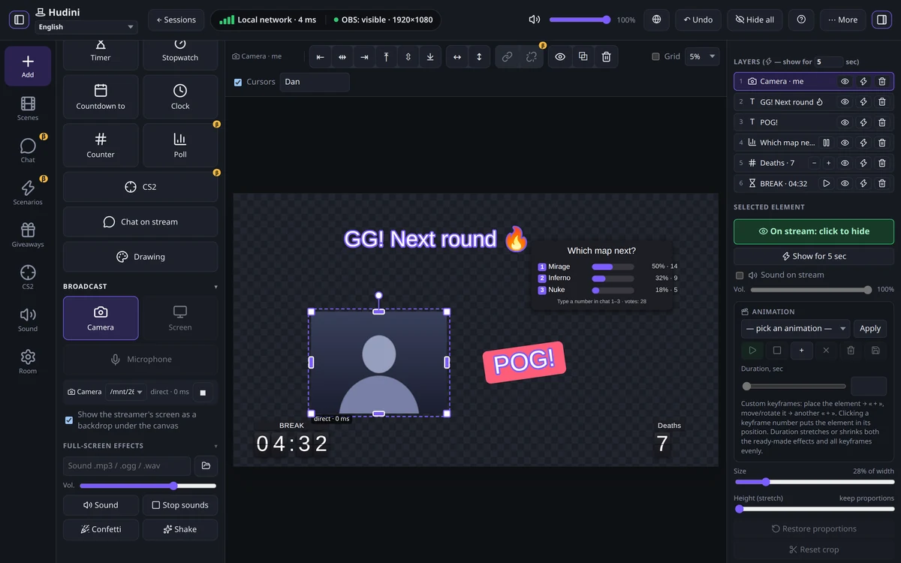
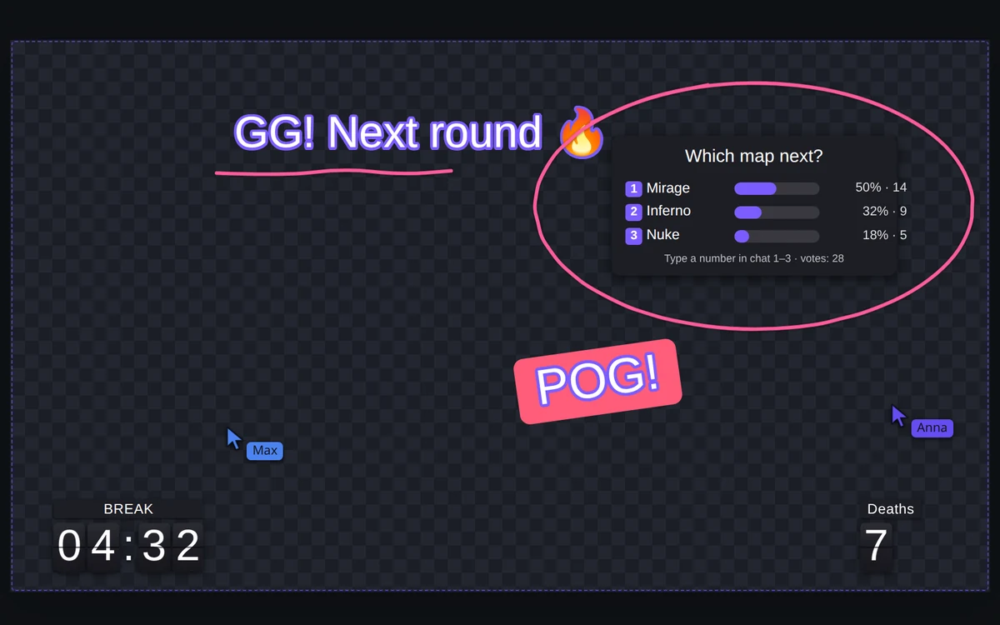
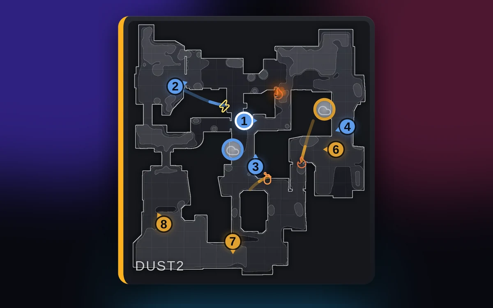

<div align="center">

[English](README.md) | [Русский](README.ru.md) | [Українська](README.uk.md) | **Deutsch**


# Hudini

**Kostenloses Open-Source-Stream-Overlay für OBS mit Fernsteuerung für deinen Moderator**

<a href="https://github.com/niko-ua-designer/hudini/releases/latest"></a>

<a href="https://niko-ua-designer.github.io/hudini/"></a>&nbsp;<a href="https://niko-ua-designer.github.io/hudini/help.html"></a><br>
<a href="https://t.me/Hudini_DEV?direct"></a>&nbsp;<a href="https://niko-ua-designer.github.io/hudini/report.html?lang=de"></a>

[](https://github.com/niko-ua-designer/hudini/releases/latest) [](LICENSE) 

<br>



</div>

## Das bekommst du

- Text, Bilder, GIFs, Videos und Websites im Stream, per Link hinzugefügt
- Ein Moderator steuert alles von seinem eigenen PC, während der Streamer einfach spielt
- Elemente verschieben, skalieren, drehen, zuschneiden und gruppieren; Rückgängig und Wiederholen, die zwischen den Pulten synchron bleiben
- Umfragen, die Stimmen aus dem Chat zählen, Flipclock-Timer und Zähler
- Chat auf dem Bildschirm mit 7TV-, BTTV- und FFZ-Emotes
- Szenarien: „Wenn ein Chat-Befehl, ein Timer-Ende, ein Zielstand eines Zählers oder ein Knopf, dann ..."
- Kamera, Bildschirm und Mikrofon von einem Moderator oder Gast, standardmäßig aus und bei jeder Anfrage bestätigt
- Mehrere Moderatoren gleichzeitig, mit Rechten pro Moderator und einer gemeinsamen Leinwand
- Direkte verschlüsselte Verbindung: keine Cloud und kein Server eines Dritten dazwischen

<table>
  <tr>
    <td width="33%"></td>
    <td width="33%"></td>
    <td width="33%"></td>
  </tr>
  <tr>
    <td align="center">Medien auf der Leinwand</td>
    <td align="center">Moderatoren arbeiten zusammen</td>
    <td align="center">CS2-HUD, Zusatzfunktion (Beta)</td>
  </tr>
</table>

## Los geht's

1. Lade ein Archiv für dein System herunter, entpacke es irgendwo und starte Hudini. Die Einstellungen liegen im Ordner `data/` daneben.
2. Streamer: öffne den Tab **Streamer**, füge den Link der Browser-Quelle in OBS ein und schick den Raumcode (`hudini1:...`) an den Moderator.
3. Moderator: öffne den Tab **Moderator**, füge den Code ein, drücke **➕ Hinzufügen** und verbinde dich.

| System | Archiv |
|---|---|
| Windows | `HudiniHost-windows-<version>.zip` |
| Linux | `HudiniHost-linux-<version>.zip` |
| macOS | `HudiniHost-mac-<version>.zip` (ein universelles Build, Apple Silicon und Intel) |

Windows und Linux aktualisieren sich selbst. Wenn du 1.0 auf einem Mac nutzt, lade die neue Version einmal von Hand herunter und behalte deinen Ordner `data/`; danach laufen die Updates automatisch.

Anleitungen, Screenshots und Antworten auf häufige Fragen: [Hilfe](https://niko-ua-designer.github.io/hudini/help.html).

## Verbinden

Streamer und Moderator verbinden sich direkt über TLS, sie brauchen also nur ein gemeinsames Netzwerk.

| Weg | In einer Zeile |
|---|---|
| Radmin VPN | Am einfachsten. Windows, beide treten einem Netzwerk bei. |
| Porthole (Steam) | Kein VPN und keine Router-Einstellungen. |
| Tailscale | Am zuverlässigsten, funktioniert hinter jedem Router. |
| ZeroTier | Gut, wenn du schon ein Netzwerk hast. |
| Portweiterleitung | Leite TCP 7778 an den PC des Streamers weiter. |

Schritt-für-Schritt-Anleitungen für jeden Weg findest du in der [Hilfe](https://niko-ua-designer.github.io/hudini/help.html).

<details>
<summary><b>Für Entwickler</b></summary>

### Projektstruktur

| Pfad | Was liegt dort |
|---|---|
| `web/shared/` | Gemeinsamer Code und Assets: `core.js`, `core.css` (Rendering), `case3d.js`, `i18n.js` (Übersetzungen des Pults: en/uk/de), `icons.js`, `help-content.js`, `connect-guides.js`, Presets, Vendor, Schriften, Icons |
| `web/widget/` | `widget.html`, die Browser-Quelle für OBS |
| `web/panel/` | Das Moderator-Pult (`moderator.html`, `moderator.js`, `ui.js`, `ui.css`) |
| `web/app/` | Startbildschirm der App, gespeicherte Sitzungen, Protokoll und Seiten zur Datenspeicherung |
| `web/site/` | Landingpage, Hilfe, die Meldeseite (`report.html`), `version.json` |
| `server/` | Hudini Host (Bun, in eine Datei gebaut) |
| `app/` | Die Desktop-App (Tauri 2) und das Verbindungs-Relay (`app/relay`, Rust) |
| `tests/` | End-to-End-Tests (Playwright) |
| `tools/` | Build-Skripte |
| `docs/` | Release-Notes und Checklisten |

### Tests

```sh
cd tests
npm install    # once
node run.js
```

Einzelne Dateien lassen sich auch separat starten, zum Beispiel `node core.test.js`.

### Build

- App (Tauri + Sidecar-Server): siehe [`app/BUILD.md`](app/BUILD.md). Führe zuerst `sh tools/build-app.sh` aus, um `app/dist/` zusammenzubauen.
- Nur der Server: `sh server/build.sh` (braucht Bun), baut eine Datei pro System.
- Site für GitHub Pages: `sh tools/build-site.sh`, Ausgabe in `_site/`.
- Release-Schritte: [`docs/RELEASING.md`](docs/RELEASING.md).

### Sicherheit

Das Sicherheitsmodell und wie du eine Schwachstelle meldest, steht in [SECURITY.md](SECURITY.md). Die Verbindung ist mit TLS verschlüsselt; das Serverzertifikat ist selbstsigniert und wird über seinen SHA-256-Fingerabdruck geprüft, der Teil des Raumcodes ist. Änderungen: [`CHANGELOG.md`](CHANGELOG.md).

### Lizenz

[GNU AGPL v3](LICENSE).

</details>
