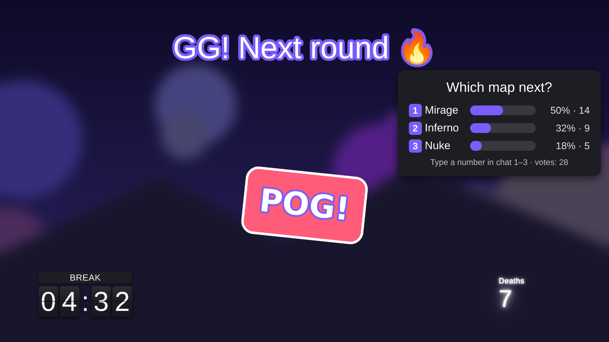

# 🎩 Hudini: a stream overlay run by your moderator

**Site:** https://niko-ua-designer.github.io/overlay/ · **Panel:** [moderator.html](https://niko-ua-designer.github.io/overlay/moderator.html) · **Help (EN/RU/UK/DE):** [help.html](https://niko-ua-designer.github.io/overlay/help.html) · **Download Hudini Host:** [Releases](https://github.com/niko-ua-designer/overlay/releases/tag/v1.0.0-rc.1)

[English](#english) · [Русский](#русский)



## English

Hudini lets a moderator show text, pictures, GIFs, videos, timers, polls, chat messages and effects on the streamer's screen from a web panel. The streamer only runs one app.

### How it fits together

| Part | Where | What it does |
|---|---|---|
| **Panel** (`moderator.html`) | Moderator's browser, installable as an app | Editing the screen, scenes, library, chat, scenarios |
| **Hudini Host** (`host/`) | Streamer's PC | Local server for OBS, encrypted file storage, CS2 data, tunnel for moderators |
| **Widget** (`widget.html`) | OBS Browser source, served by Hudini Host | Draws the overlay, accepts only signed changes |

The public MQTT server is used only for an encrypted announcement of the Host's address. Screen state, files and CS2 data go directly through the Host.

### Quick start

1. **Streamer:** download Hudini Host from [Releases](https://github.com/niko-ua-designer/overlay/releases/tag/v1.0.0-rc.1), unzip, run. On first start it asks how much space to give moderators' files (100 MB per file, 2 GB, 300 files by default).
2. **Moderator:** open the [panel](https://niko-ua-designer.github.io/overlay/moderator.html), press **📋 Copy** and send the link to the streamer.
3. **Streamer:** paste the link into Hudini Host, copy the OBS link it shows, add it in OBS as a Browser source with **1920×1080**, press `Ctrl+F`.

The panel finds the Host by itself and shows a short tour on first use. Full guide: [help.html](https://niko-ua-designer.github.io/overlay/help.html).

### Features

Stable: text, pictures, GIFs, video; move, resize, rotate, stretch; hide, show, flash; layers; undo; Ctrl+C/Ctrl+V; rooms, keys, invites, password, backup; timers; manual counters; scenes; library; animations; sounds, confetti, shake; four languages; your own panel layout.

**β beta:** Hudini Host (tunnel, auto-update); chat feed and messages; chat counters and polls; YouTube, Twitch and websites with volume; webcam; file uploads; CS2 for the player; scenarios; multi-select, groups, grid.

**α alpha:** CS2 observer views; Twitch pause and seek.

### Security in short

- Every change is encrypted (AES-256-GCM) and signed (ECDSA P-256) in the panel; the widget verifies the signature and drops forgeries and replays.
- Room keys live in the link after `#`, which browsers never send to a server. The private signing key never leaves the moderator's browser.
- Files are stored on the streamer's PC encrypted; the Host can't read them and can't swap one file for another.
- The Host listens on `127.0.0.1` only, checks `Host` and `Origin` headers, needs a password for moderators (with a pause after wrong guesses) and a token for CS2.
- Supply chain: mqtt.js with an SRI hash, cloudflared pinned by SHA-256, CI actions pinned by commit, updates verified with SHA-256.
- Panel and widget have a Content Security Policy.

### Development

```sh
cd tests && npm ci && npx playwright install chromium   # once
npm test                 # end-to-end: panel + Hudini Host + widget in Chromium
node run.js update       # self-update with two compiled Host builds
```

The Host runs from source with Bun: `cd host && npm ci && bun run server.js`. Releases are built by GitHub Actions when a tag `v1.2.3` or `v1.2.3-rc.1` matching `const VERSION` in `host/server.js` is pushed. Interface text is written in Russian and translated by `i18n.js` (EN, UK, DE); add new phrases there in all languages. Help texts live in `help-content.js`.

### License

The code is licensed under **AGPL-3.0** ([LICENSE](LICENSE)). Ready-made animations in [`presets/`](presets/) are under **MIT** ([presets/LICENSE](presets/LICENSE)), so you can reuse them anywhere.

Problems and ideas: [Issues](https://github.com/niko-ua-designer/overlay/issues).

---

## Русский

Hudini позволяет модератору показывать на экране стримера текст, картинки, GIF, видео, таймеры, голосования, сообщения из чата и эффекты из веб-пульта. Стримеру нужно только запустить одну программу.

### Из чего состоит

| Часть | Где | Что делает |
|---|---|---|
| **Пульт** (`moderator.html`) | Браузер модератора, можно установить как приложение | Редактирование экрана, сцены, библиотека, чат, сценарии |
| **Hudini Host** (`host/`) | ПК стримера | Локальный сервер для OBS, зашифрованное хранилище файлов, данные CS2, туннель для модераторов |
| **Виджет** (`widget.html`) | Источник «Браузер» в OBS, его отдаёт Hudini Host | Рисует оверлей, принимает только подписанные изменения |

Общий MQTT-сервер нужен только для зашифрованного объявления адреса программы. Экран, файлы и данные CS2 идут напрямую через Hudini Host.

### Быстрый старт

1. **Стример:** скачай Hudini Host со страницы [Releases](https://github.com/niko-ua-designer/overlay/releases/tag/v1.0.0-rc.1), распакуй и запусти. При первом запуске программа спросит, сколько места дать файлам модераторов (по умолчанию 100 МБ на файл, 2 ГБ, 300 файлов).
2. **Модератор:** открой [пульт](https://niko-ua-designer.github.io/overlay/moderator.html), нажми **📋 Копировать** и отправь ссылку стримеру.
3. **Стример:** вставь ссылку в Hudini Host, скопируй ссылку для OBS, добавь в OBS источник «Браузер» **1920×1080** и нажми `Ctrl+F`.

Пульт сам находит программу и при первом входе показывает короткое обучение. Подробная справка: [help.html](https://niko-ua-designer.github.io/overlay/help.html).

### Возможности

Стабильно: текст, картинки, GIF, видео; двигать, менять размер, крутить, растягивать; прятать, показывать, «на N секунд»; слои; отмена; Ctrl+C/Ctrl+V; комнаты, ключи, приглашения, пароль, бэкап; таймеры; ручные счётчики; сцены; библиотека; анимации; звуки, конфетти, тряска; четыре языка; свой вид пульта.

**β бета:** Hudini Host (туннель, автообновление); лента чата и сообщения; счётчики чата и голосования; YouTube, Twitch и сайты с громкостью; вебка; загрузка файлов; CS2 для игрока; сценарии; выделение нескольких, группы, сетка.

**α альфа:** режим наблюдателя CS2; пауза и перемотка Twitch.

### Безопасность коротко

- Каждое изменение шифруется (AES-256-GCM) и подписывается (ECDSA P-256) в пульте; виджет проверяет подпись и отбрасывает подделки и повторы.
- Ключи комнаты лежат в ссылке после `#`, браузер не отправляет эту часть на сервер. Закрытый ключ подписи не покидает браузер модератора.
- Файлы хранятся у стримера зашифрованными: программа не может их прочитать или подменить один на другой.
- Программа слушает только `127.0.0.1`, проверяет заголовки `Host` и `Origin`, пускает модераторов по паролю (с паузой после неверных попыток), CS2 по токену.
- Цепочка поставок: mqtt.js с хешем SRI, cloudflared с проверкой SHA-256, действия CI закреплены по коммиту, обновления сверяются по SHA-256.
- У пульта и виджета есть Content Security Policy.

### Для разработчиков

```sh
cd tests && npm ci && npx playwright install chromium   # один раз
npm test                 # сквозные тесты: пульт + Hudini Host + виджет в Chromium
node run.js update       # автообновление на двух собранных версиях программы
```

Программа запускается из исходников через Bun: `cd host && npm ci && bun run server.js`. Релизы собирает GitHub Actions по тегу `v1.2.3` или `v1.2.3-rc.1`, он должен совпадать с `const VERSION` в `host/server.js`. Тексты интерфейса пишутся по-русски и переводятся в `i18n.js` (EN, UK, DE): новые фразы добавляй туда на всех языках. Тексты справки лежат в `help-content.js`.

### Лицензия

Код под лицензией **AGPL-3.0** ([LICENSE](LICENSE)). Готовые анимации в [`presets/`](presets/) под **MIT** ([presets/LICENSE](presets/LICENSE)): их можно брать куда угодно.

Проблемы и идеи: [Issues](https://github.com/niko-ua-designer/overlay/issues).
