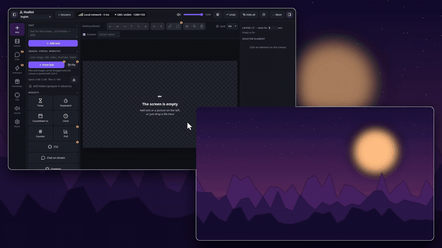
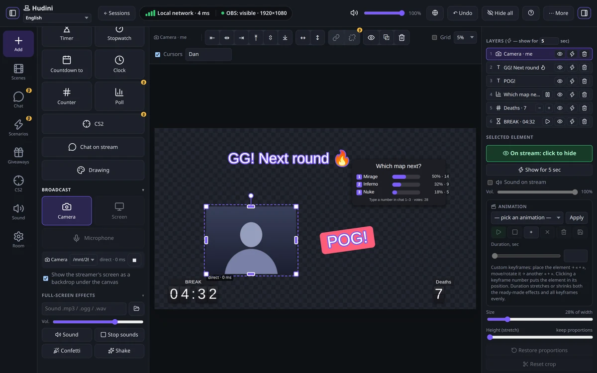
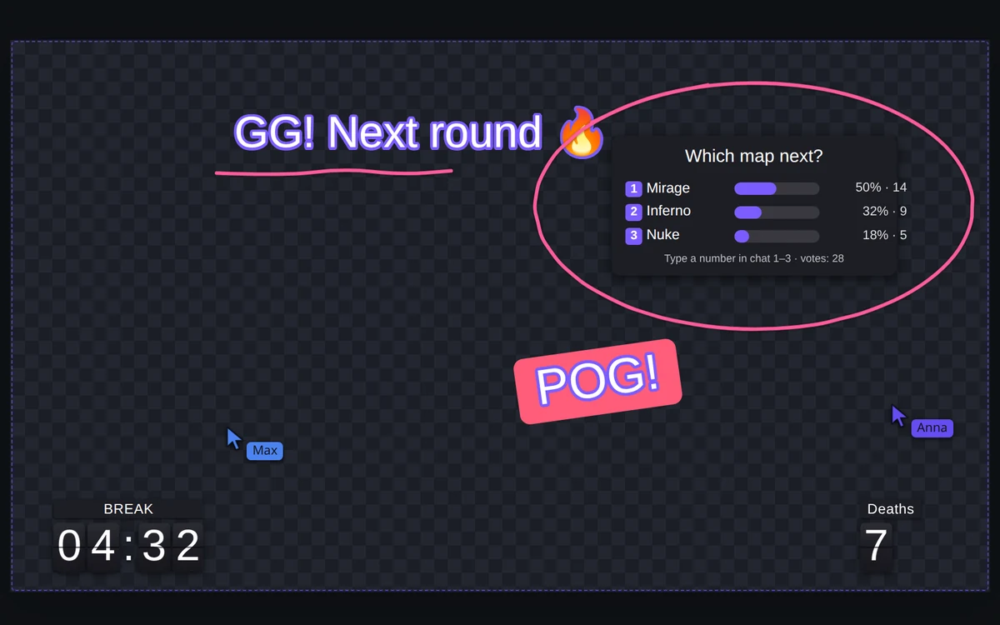
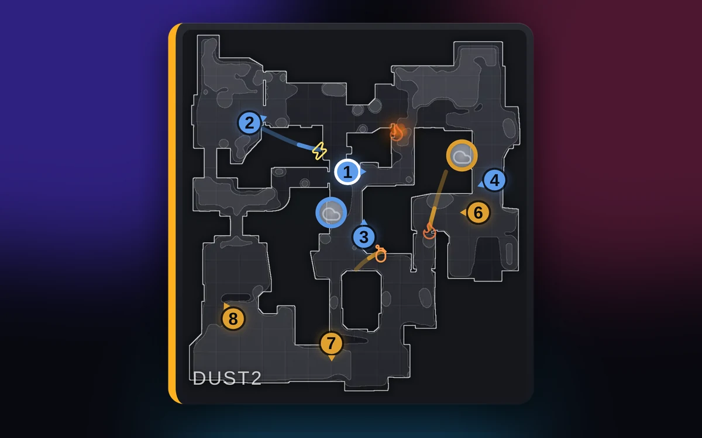

<div align="center">

**English** | [Русский](README.ru.md) | [Українська](README.uk.md) | [Deutsch](README.de.md)


# Hudini

**Free, open-source stream overlay for OBS with a remote control for your moderator**

<a href="https://github.com/niko-ua-designer/hudini/releases/latest"></a>

<a href="https://niko-ua-designer.github.io/hudini/"></a>&nbsp;<a href="https://niko-ua-designer.github.io/hudini/help.html"></a><br>
<a href="https://t.me/Hudini_DEV?direct"></a>&nbsp;<a href="https://niko-ua-designer.github.io/hudini/report.html?lang=en"></a>

[](https://github.com/niko-ua-designer/hudini/releases/latest) [](LICENSE) 

<br>



</div>

## What you get

- Text, pictures, GIFs, videos and websites on stream, added by link
- A moderator runs everything from their own PC while the streamer just plays
- Move, scale, rotate, crop and group elements; undo and redo that sync between panels
- Polls that count votes from chat, flip-clock timers and counters
- Chat on screen with 7TV, BTTV and FFZ emotes
- Scenarios: "if a chat command, a timer end, a counter goal or a button, then ..."
- Camera, screen and microphone from a moderator or guest, off by default and confirmed on every request
- Several moderators at once, with per-moderator permissions and a shared canvas
- Direct encrypted connection: no cloud and no third-party server in the middle

<table>
  <tr>
    <td width="33%"></td>
    <td width="33%"></td>
    <td width="33%"></td>
  </tr>
  <tr>
    <td align="center">Media on the canvas</td>
    <td align="center">Moderators working together</td>
    <td align="center">CS2 HUD, an extra (beta)</td>
  </tr>
</table>

## Get started

1. Download one archive for your system, unzip it anywhere and start Hudini. Settings live in the `data/` folder next to it.
2. Streamer: open the **Streamer** tab, add the Browser source link to OBS, and send the room code (`hudini1:...`) to the moderator.
3. Moderator: open the **Moderator** tab, paste the code, press **➕ Add** and connect.

| System | Archive |
|---|---|
| Windows | `HudiniHost-windows-<version>.zip` |
| Linux | `HudiniHost-linux-<version>.zip` |
| macOS | `HudiniHost-mac-<version>.zip` (one universal build, Apple Silicon and Intel) |

Windows and Linux update themselves. If you run 1.0 on a Mac, download the new version by hand once and keep your `data/` folder; after that updates are automatic.

Guides, screenshots and answers to common questions: [Help](https://niko-ua-designer.github.io/hudini/help.html).

## Connecting

The streamer and the moderator connect directly over TLS, so they only need a network in common.

| Way | In one line |
|---|---|
| Radmin VPN | Easiest. Windows, both join one network. |
| Porthole (Steam) | No VPN and no router settings. |
| Tailscale | Most reliable, works through any router. |
| ZeroTier | Good if you already have a network. |
| Port forwarding | Forward TCP 7778 to the streamer's PC. |

Step-by-step guides for each way are in the [Help](https://niko-ua-designer.github.io/hudini/help.html).

<details>
<summary><b>For developers</b></summary>

### Project structure

| Path | What is there |
|---|---|
| `web/shared/` | Shared code and assets: `core.js`, `core.css` (render), `case3d.js`, `i18n.js` (panel translations: en/uk/de), `icons.js`, `help-content.js`, `connect-guides.js`, presets, vendor, fonts, icons |
| `web/widget/` | `widget.html`, the OBS browser source |
| `web/panel/` | The moderator panel (`moderator.html`, `moderator.js`, `ui.js`, `ui.css`) |
| `web/app/` | App start screen, saved sessions, log and data storage pages |
| `web/site/` | Landing page, help, the report page (`report.html`), `version.json` |
| `server/` | Hudini Host (Bun, built into one file) |
| `app/` | The desktop app (Tauri 2) and the connection relay (`app/relay`, Rust) |
| `tests/` | End-to-end tests (Playwright) |
| `tools/` | Build scripts |
| `docs/` | Release notes and checklists |

### Tests

```sh
cd tests
npm install    # once
node run.js
```

Single files can be run on their own, for example `node core.test.js`.

### Build

- App (Tauri + sidecar server): see [`app/BUILD.md`](app/BUILD.md). Run `sh tools/build-app.sh` first to assemble `app/dist/`.
- Server only: `sh server/build.sh` (needs Bun), builds one file per system.
- Site for GitHub Pages: `sh tools/build-site.sh`, output in `_site/`.
- Release steps: [`docs/RELEASING.md`](docs/RELEASING.md).

### Security

See [SECURITY.md](SECURITY.md) for the security model and how to report a vulnerability. The connection is encrypted with TLS; the server certificate is self-signed and checked by its SHA-256 fingerprint, which is part of the room code. Changes: [`CHANGELOG.md`](CHANGELOG.md).

### License

[GNU AGPL v3](LICENSE).

</details>
