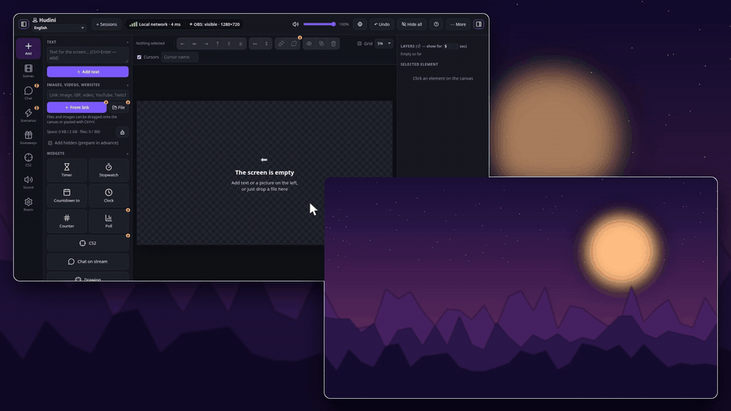
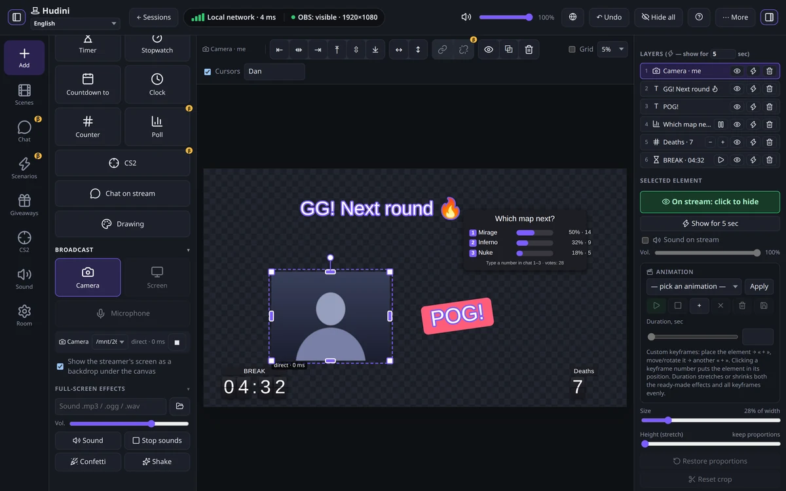
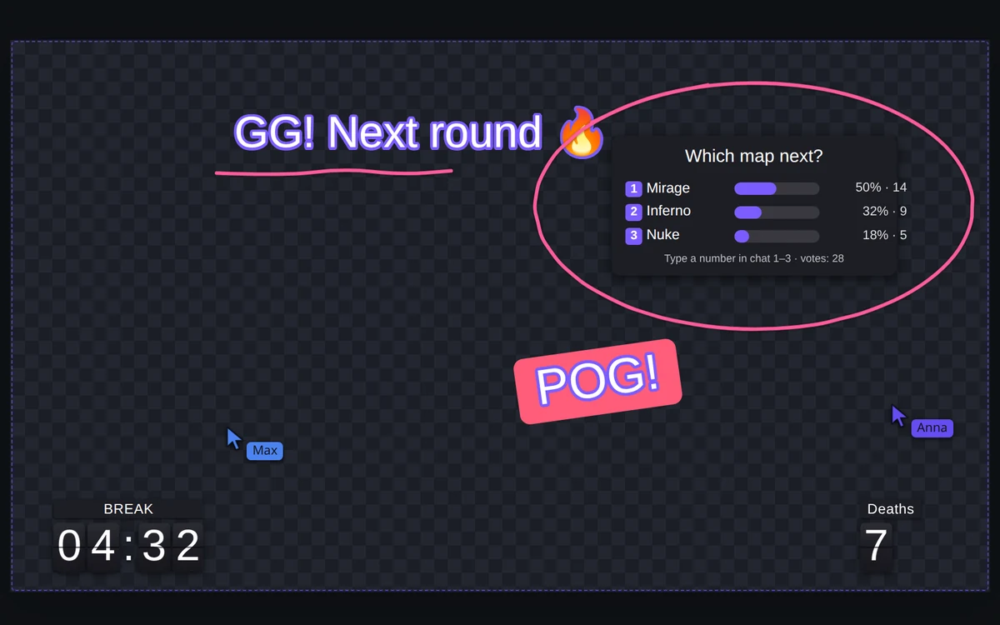
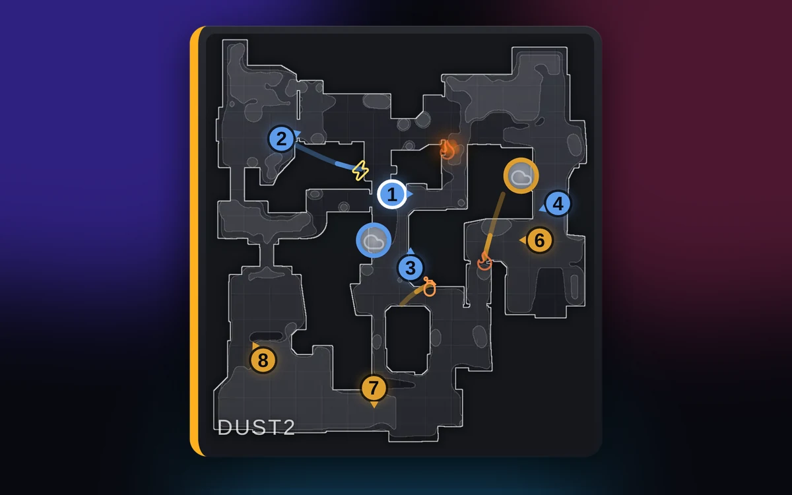

<div align="center">

[English](README.md) | **Русский** | [Українська](README.uk.md) | [Deutsch](README.de.md)


# Hudini

**Бесплатный оверлей для стрима в OBS с открытым кодом и пультом для вашего модератора**

<a href="https://github.com/niko-ua-designer/hudini/releases/latest"></a>

<a href="https://niko-ua-designer.github.io/hudini/"></a>&nbsp;<a href="https://niko-ua-designer.github.io/hudini/help.html"></a><br>
<a href="https://t.me/Hudini_DEV?direct"></a>&nbsp;<a href="https://niko-ua-designer.github.io/hudini/report.html?lang=ru"></a>

[](https://github.com/niko-ua-designer/hudini/releases/latest) [](LICENSE) 

<br>



</div>

## Что вы получаете

- Текст, картинки, GIF, видео и сайты на стриме, добавляются по ссылке
- Модератор управляет всем со своего ПК, пока стример просто играет
- Перемещение, масштаб, поворот, обрезка и группировка элементов; отмена и повтор действий синхронизируются между пультами
- Опросы, которые считают голоса из чата, таймеры-флипы и счётчики
- Чат на экране со смайлами 7TV, BTTV и FFZ
- Сценарии: «если команда в чате, конец таймера, цель счётчика или кнопка, то ...»
- Камера, экран и микрофон от модератора или гостя: по умолчанию выключены и подтверждаются при каждом запросе
- Несколько модераторов одновременно, с правами для каждого и общим холстом
- Прямое зашифрованное соединение: без облака и сторонних серверов посередине

<table>
  <tr>
    <td width="33%"></td>
    <td width="33%"></td>
    <td width="33%"></td>
  </tr>
  <tr>
    <td align="center">Медиа на холсте</td>
    <td align="center">Модераторы работают вместе</td>
    <td align="center">CS2 HUD, дополнение (бета)</td>
  </tr>
</table>

## Быстрый старт

1. Скачайте один архив для своей системы, распакуйте куда угодно и запустите Hudini. Настройки хранятся в папке `data/` рядом с программой.
2. Стример: выберите **Я стример**, добавьте ссылку Browser source в OBS и отправьте модератору код комнаты (`hudini1:...`).
3. Модератор: выберите **Я модератор**, вставьте код и подключитесь.

| Система | Архив |
|---|---|
| Windows | `HudiniHost-windows-<version>.zip` |
| Linux | `HudiniHost-linux-<version>.zip` |
| macOS | `HudiniHost-mac-<version>.zip` (одна универсальная сборка, Apple Silicon и Intel) |

Windows и Linux обновляются сами. Если на Mac у вас версия 1.0, один раз скачайте новую версию вручную и сохраните папку `data/`; дальше обновления идут автоматически.

Руководства, скриншоты и ответы на частые вопросы: [Справка](https://niko-ua-designer.github.io/hudini/help.html).

## Подключение

Стример и модератор соединяются напрямую по TLS, поэтому им нужна только общая сеть.

| Способ | Одной строкой |
|---|---|
| Radmin VPN | Проще всего. Windows, оба входят в одну сеть. |
| Porthole (Steam) | Без VPN и без настроек роутера. |
| Tailscale | Надёжнее всего, работает через любой роутер. |
| ZeroTier | Подходит, если у вас уже есть сеть. |
| Проброс портов | Пробросьте TCP 7778 на ПК стримера. |

Пошаговые инструкции по каждому способу есть в [Справке](https://niko-ua-designer.github.io/hudini/help.html).

<details>
<summary><b>Для разработчиков</b></summary>

### Структура проекта

| Путь | Что там |
|---|---|
| `web/shared/` | Общий код и ресурсы: `core.js`, `core.css` (рендер), `case3d.js`, `i18n.js` (переводы пульта: en/uk/de), `icons.js`, `help-content.js`, `connect-guides.js`, пресеты, vendor, шрифты, иконки |
| `web/widget/` | `widget.html`, источник Browser source для OBS |
| `web/panel/` | Пульт модератора (`moderator.html`, `moderator.js`, `ui.js`, `ui.css`) |
| `web/app/` | Стартовый экран приложения, сохранённые сессии, страницы журнала и хранения данных |
| `web/site/` | Лендинг, справка, страница отчётов (`report.html`), `version.json` |
| `server/` | Hudini Host (Bun, собирается в один файл) |
| `app/` | Десктопное приложение (Tauri 2) и ретранслятор соединения (`app/relay`, Rust) |
| `tests/` | Сквозные тесты (Playwright) |
| `tools/` | Скрипты сборки |
| `docs/` | Заметки о релизах и чек-листы |

### Тесты

```sh
cd tests
npm install    # один раз
node run.js
```

Отдельные файлы можно запускать по одному, например `node core.test.js`.

### Сборка

- Приложение (Tauri + серверный sidecar): см. [`app/BUILD.md`](app/BUILD.md). Сначала запустите `sh tools/build-app.sh`, чтобы собрать `app/dist/`.
- Только сервер: `sh server/build.sh` (нужен Bun), собирает по одному файлу на каждую систему.
- Сайт для GitHub Pages: `sh tools/build-site.sh`, результат в `_site/`.
- Шаги релиза: [`docs/RELEASING.md`](docs/RELEASING.md).

### Безопасность

Модель безопасности и порядок сообщения об уязвимости описаны в [SECURITY.md](SECURITY.md). Соединение шифруется TLS; сертификат сервера самоподписанный и проверяется по отпечатку SHA-256, который входит в код комнаты. Список изменений: [`CHANGELOG.md`](CHANGELOG.md).

### Лицензия

[GNU AGPL v3](LICENSE).

</details>
