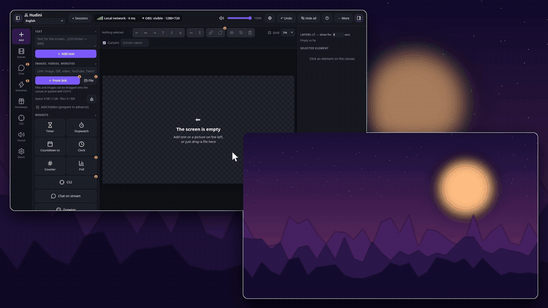
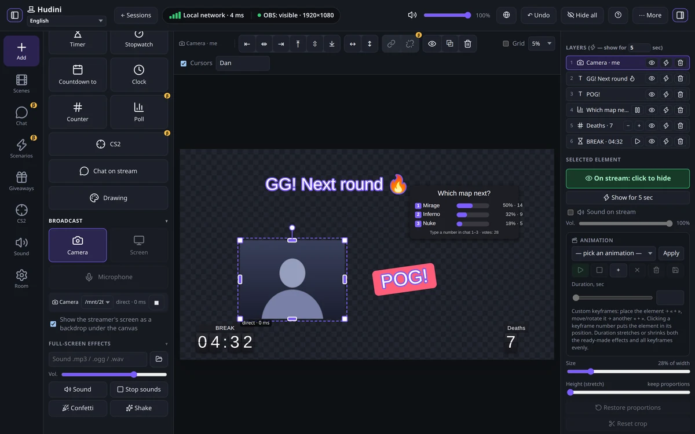
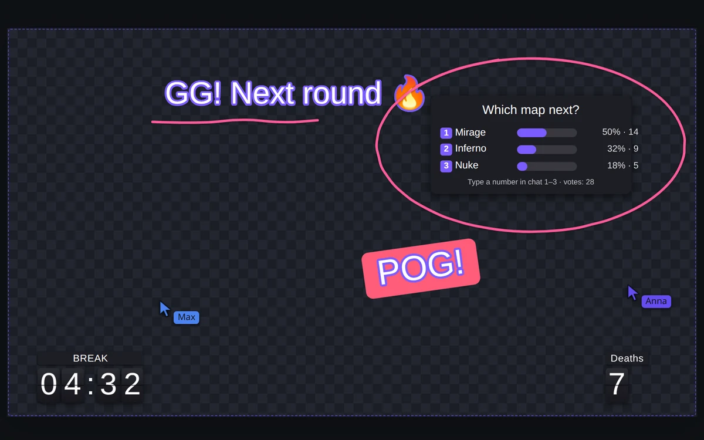
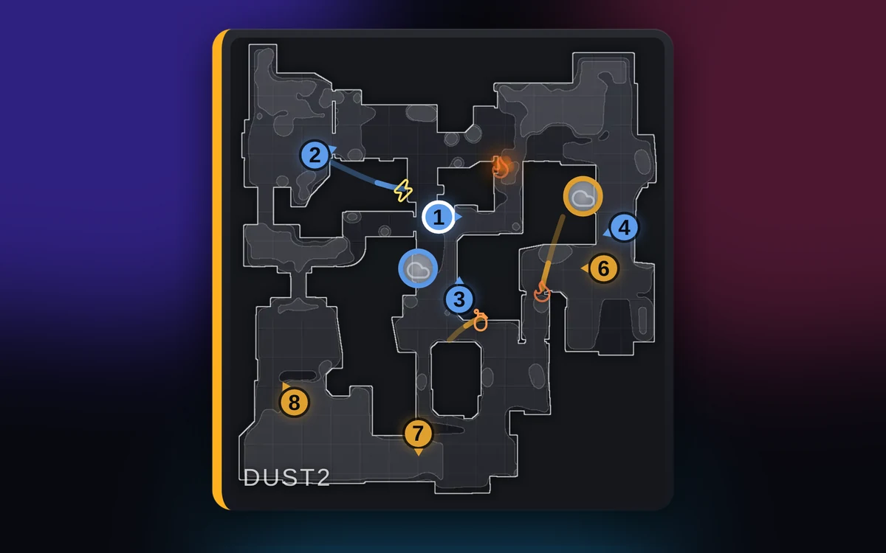

<div align="center">

[English](README.md) | [Русский](README.ru.md) | **Українська** | [Deutsch](README.de.md)


# Hudini

**Безкоштовний оверлей для стрімів з відкритим кодом для OBS, з пультом дистанційного керування для вашого модератора**

<a href="https://github.com/niko-ua-designer/hudini/releases/latest"></a>

<a href="https://niko-ua-designer.github.io/hudini/"></a>&nbsp;<a href="https://niko-ua-designer.github.io/hudini/help.html"></a><br>
<a href="https://t.me/Hudini_DEV?direct"></a>&nbsp;<a href="https://niko-ua-designer.github.io/hudini/report.html?lang=uk"></a>

[](https://github.com/niko-ua-designer/hudini/releases/latest) [](LICENSE) 

<br>



</div>

## Що ви отримуєте

- Текст, картинки, GIF, відео та сайти на стрімі, які додаються за посиланням
- Модератор керує всім зі свого ПК, а стрімер просто грає
- Переміщення, масштабування, поворот, обрізання та групування елементів; скасування і повернення дій синхронізуються між пультами
- Опитування, які рахують голоси з чату, таймери-перекидні годинники та лічильники
- Чат на екрані зі смайлами 7TV, BTTV і FFZ
- Сценарії: «якщо команда в чаті, завершення таймера, мета лічильника або кнопка, то ...»
- Камера, екран і мікрофон від модератора чи гостя: за замовчуванням вимкнені та підтверджуються при кожному запиті
- Кілька модераторів одночасно, з окремими правами для кожного та спільним полотном
- Пряме зашифроване з'єднання: без хмари та без стороннього сервера посередині

<table>
  <tr>
    <td width="33%"></td>
    <td width="33%"></td>
    <td width="33%"></td>
  </tr>
  <tr>
    <td align="center">Медіа на полотні</td>
    <td align="center">Модератори працюють разом</td>
    <td align="center">CS2 HUD, додаток (бета)</td>
  </tr>
</table>

## Швидкий старт

1. Завантажте один архів для своєї системи, розпакуйте його куди завгодно та запустіть Hudini. Налаштування зберігаються в папці `data/` поруч із програмою.
2. Стрімер: відкрийте вкладку **Стрімер**, додайте посилання Browser source в OBS і надішліть модератору код кімнати (`hudini1:...`).
3. Модератор: відкрийте вкладку **Модератор**, вставте код, натисніть **➕ Додати** і підключіться.

| Система | Архів |
|---|---|
| Windows | `HudiniHost-windows-<version>.zip` |
| Linux | `HudiniHost-linux-<version>.zip` |
| macOS | `HudiniHost-mac-<version>.zip` (одна універсальна збірка, Apple Silicon та Intel) |

Windows і Linux оновлюються самі. Якщо на Mac у вас версія 1.0, один раз завантажте нову версію вручну та збережіть свою папку `data/`; після цього оновлення відбуваються автоматично.

Посібники, скриншоти та відповіді на поширені запитання: [Довідка](https://niko-ua-designer.github.io/hudini/help.html).

## Підключення

Стрімер і модератор підключаються напряму по TLS, тож їм потрібна лише спільна мережа.

| Спосіб | Одним рядком |
|---|---|
| Radmin VPN | Найпростіше. Windows, обидва заходять в одну мережу. |
| Porthole (Steam) | Без VPN і без налаштувань роутера. |
| Tailscale | Найнадійніше, працює через будь-який роутер. |
| ZeroTier | Добре, якщо у вас уже є мережа. |
| Проброс портів | Прокиньте TCP 7778 на ПК стрімера. |

Покрокові інструкції для кожного способу є в [Довідці](https://niko-ua-designer.github.io/hudini/help.html).

<details>
<summary><b>Для розробників</b></summary>

### Структура проєкту

| Шлях | Що там |
|---|---|
| `web/shared/` | Спільний код і ресурси: `core.js`, `core.css` (рендер), `case3d.js`, `i18n.js` (переклади пульта: en/uk/de), `icons.js`, `help-content.js`, `connect-guides.js`, пресети, vendor, шрифти, іконки |
| `web/widget/` | `widget.html`, джерело браузера для OBS |
| `web/panel/` | Пульт модератора (`moderator.html`, `moderator.js`, `ui.js`, `ui.css`) |
| `web/app/` | Стартовий екран програми, збережені сесії, журнал і сторінки сховища даних |
| `web/site/` | Лендінг, довідка, сторінка звітів (`report.html`), `version.json` |
| `server/` | Hudini Host (Bun, збирається в один файл) |
| `app/` | Десктопна програма (Tauri 2) і ретранслятор з'єднання (`app/relay`, Rust) |
| `tests/` | Наскрізні тести (Playwright) |
| `tools/` | Скрипти збирання |
| `docs/` | Нотатки до релізів і чеклисти |

### Тести

```sh
cd tests
npm install    # once
node run.js
```

Окремі файли можна запускати самостійно, наприклад `node core.test.js`.

### Збирання

- Програма (Tauri + серверний sidecar): див. [`app/BUILD.md`](app/BUILD.md). Спочатку виконайте `sh tools/build-app.sh`, щоб зібрати `app/dist/`.
- Лише сервер: `sh server/build.sh` (потрібен Bun), збирає по одному файлу для кожної системи.
- Сайт для GitHub Pages: `sh tools/build-site.sh`, результат у `_site/`.
- Кроки випуску релізу: [`docs/RELEASING.md`](docs/RELEASING.md).

### Безпека

Модель безпеки та спосіб повідомити про вразливість дивіться в [SECURITY.md](SECURITY.md). З'єднання шифрується по TLS; сертифікат сервера самопідписаний і перевіряється за відбитком SHA-256, який входить до коду кімнати. Зміни: [`CHANGELOG.md`](CHANGELOG.md).

### Ліцензія

[GNU AGPL v3](LICENSE).

</details>
